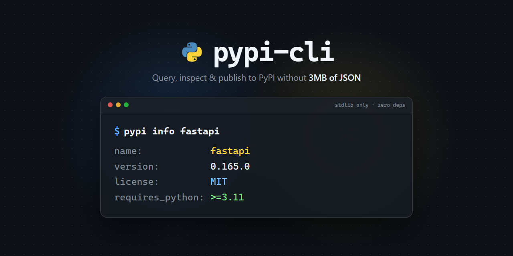

<p align="center">
  
</p>

<p align="center">
  <strong>Query, inspect, and publish to PyPI from your terminal without downloading 3MB of JSON.</strong>
</p>

<p align="center">
  <a href="https://www.python.org/downloads/"></a>
  
  <a href="https://opensource.org/licenses/MIT"></a>
</p>

---

## Why this exists

`pip search` was disabled in 2020. `pypi.org/search/` sits behind a Fastly JS challenge. And hitting `pypi.org/pypi/<pkg>/json` for a package like `boto3` returns **3.2 MB** of raw release hashes just to read a version number or dependency list.

That hurts shell scripts and burns LLM context windows fast when an AI coding agent inspects packages.

`pypi-cli` talks straight to PyPI's JSON and PEP 691 Simple APIs over HTTPS with gzip compression, strips away release hash noise, and prints short **Key-Value** or **TSV** lines using only Python's standard library.

---

## Install

```bash
git clone https://github.com/qsardor/pypi-cli.git
cd pypi-cli
pip install -e .
```

Requires Python 3.8+. Optional: [`uv`](https://github.com/astral-sh/uv) (or `build` + `twine`) if you want to build and publish packages with it.

---

## Commands

| Command | What it does | Example |
| :--- | :--- | :--- |
| `info` | Metadata, PEP 639 license, Python bounds | `pypi info fastapi` |
| `check` | Concurrent `HEAD` name check + PEP 508 validation | `pypi check pkg1 pkg2` |
| `deps` | Print `requires_dist` (`--core` or `--extra <name>`) | `pypi deps fastapi --core` |
| `versions` | Release history via PEP 691 (`-n N`, `--stable`) | `pypi versions requests -n 5 --stable` |
| `files` | Wheels, sdists, sizes, `yanked` flag | `pypi files requests==2.31.0` |
| `stats` | Daily, weekly, monthly downloads (`pypistats.org`) | `pypi stats numpy` |
| `build` | Compile sdist and wheel (`uv` or `python -m build`) | `pypi build` |
| `publish` | Upload distributions (`uv publish` or `twine`) | `pypi publish --dry-run` |
| `auth` | Read or update `~/.pypirc` without wiping mirrors | `pypi auth` |

Run `pypi --help <command>` for topic examples.

---

## Examples

Check package metadata without triggering multi-line license dumps:

```bash
$ pypi info fastapi
name: fastapi
version: 0.165.0
summary: FastAPI framework, high performance, easy to learn, fast to code, ready for production
author: Sebastián Ramírez <tiangolo@gmail.com>
license: MIT
requires_python: >=3.11
homepage: https://pypi.org/project/fastapi/
urls: Changelog=https://fastapi.tiangolo.com/release-notes/; Documentation=https://fastapi.tiangolo.com/; Homepage=https://github.com/fastapi/fastapi; Issues=https://github.com/fastapi/fastapi/issues; Repository=https://github.com/fastapi/fastapi
total_releases: 371
```

Check multiple package names at once (concurrent zero-body `HEAD` requests):

```bash
$ pypi check requests "bad/name" my-free-pkg-name
name: requests	status: TAKEN
name: bad/name	status: INVALID_NAME (PEP 508 syntax error)
name: my-free-pkg-name	status: AVAILABLE
```

Inspect wheels and sizes before installing:

```bash
$ pypi files requests==2.31.0
name: requests	version: 2.31.0	total_files: 2
filename	type	size	requires_python	yanked
requests-2.31.0-py3-none-any.whl	bdist_wheel	61.1KB	>=3.7	False
requests-2.31.0.tar.gz	sdist	108.2KB	>=3.7	False
```

---

## Security & Performance Notes

* **75%+ smaller payloads:** Requests `gzip`/`deflate` (standard `urllib.request` skips this by default) and caps both wire reads and decompressed size to block decompression bombs.
* **No tokens in process arguments:** `pypi auth` writes strictly to `~/.pypirc` (preserving existing sections and enforcing `0600` permissions on POSIX). `pypi publish` strips `--token` from child `argv` and forwards credentials only through environment variables (`UV_PUBLISH_TOKEN` / `TWINE_PASSWORD`).
* **Input and redirect checks:** Enforces PEP 508 package names and PEP 440 version characters before making network calls, and blocks any `https://` to `http://` redirect.

---

<p align="center">
  Created by Antigravity &amp; Q.S@RDOR · MIT License
</p>
